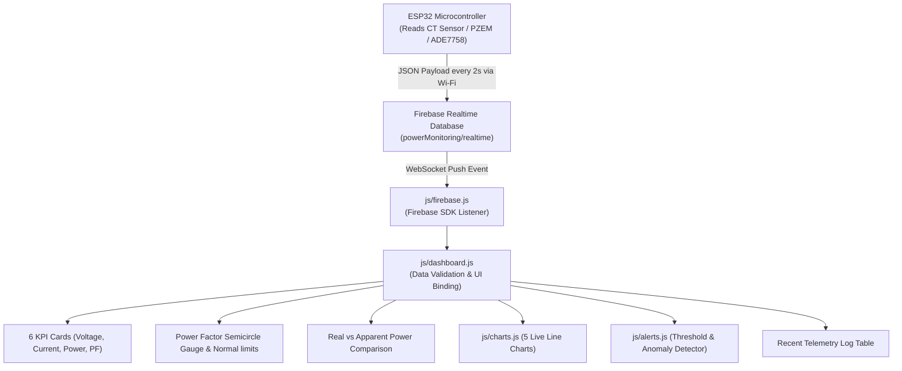

# Smart Electrical Power Monitoring System

A professional, real-time Industrial IoT / SCADA-grade web monitoring dashboard designed to interface with an **ESP32** microcontroller through **Firebase Realtime Database**.

---

## 1. Files & Directory Structure

```
c:\HTH 2.0\
 ├── dashboard/
 │    ├── index.html            # Main SCADA Dashboard Interface
 │    ├── css/
 │    │    ├── style.css        # Industrial IoT SCADA Dark/Light Theme styling
 │    │    └── responsive.css   # Responsive layout rules (Desktop, Tablet, Mobile)
 │    └── js/
 │         ├── firebase.js      # Modular Firebase Realtime Database Client & Configuration
 │         ├── theme.js         # Dark/Light Mode Manager (with localStorage persistence)
 │         ├── alerts.js        # Dynamic Electrical Threshold & Alert Notification Engine
 │         ├── charts.js        # Chart.js Real-time Telemetry Graph Controller (5 graphs + bar comparison)
 │         ├── dashboard.js     # UI Data Binding, KPI cards, Watchdog & Gauge controller
 │         └── app.js           # Application Bootstrap, Modal & Listener orchestrator
 ├── index.html                 # Root index entry
 ├── esp32_example.ino          # Complete ESP32 Arduino C++ Firmware sketch
 └── README.md                  # Comprehensive Documentation & Setup Guide
```

---

## 2. Firebase Configuration Location

You can configure your Firebase credentials in **either of two ways**:

### Option A: Edit the JavaScript Configuration File
Open [dashboard/js/firebase.js](file:///c:/HTH%202.0/dashboard/js/firebase.js) and update the `defaultFirebaseConfig` object:
```javascript
const defaultFirebaseConfig = {
  apiKey: "AIzaSyYOUR_ACTUAL_API_KEY",
  authDomain: "your-project-id.firebaseapp.com",
  databaseURL: "https://your-project-id-default-rtdb.firebaseio.com",
  projectId: "your-project-id",
  storageBucket: "your-project-id.appspot.com",
  messagingSenderId: "1234567890",
  appId: "1:1234567890:web:abcdef123456"
};
```

### Option B: Use the In-Dashboard Settings Modal
1. Open `dashboard/index.html` in any web browser.
2. Click the **Settings (Gear icon)** in the top right corner.
3. Paste your **API Key** and **Database URL**.
4. Click **Save & Connect**. The credentials will be saved securely to your browser's `localStorage` and the listener will start immediately.

---

## 3. Firebase Database Paths Used

The dashboard subscribes in real time to the following paths under your Firebase Realtime Database root:

| Path | Purpose | Listener Type |
| :--- | :--- | :--- |
| `powerMonitoring/realtime/` | Live instantaneous telemetry from ESP32 | `on('value')` Real-time |
| `powerMonitoring/history/` | Historical time-series telemetry records | `on('value')` Periodic/History |
| `powerMonitoring/system/` | ESP32 Heartbeat, Wi-Fi RSSI, Device Name | `on('value')` System Health |
| `powerMonitoring/alerts/` | Remote alert messages and status logs | `on('value')` Alert Feed |

---

## 4. How to Connect ESP32

1. Open Arduino IDE or VS Code with PlatformIO.
2. Install the **Firebase ESP Client** library by Mobizt.
3. Open [`esp32_example.ino`](file:///c:/HTH%202.0/esp32_example.ino).
4. Enter your Wi-Fi credentials:
   ```cpp
   #define WIFI_SSID "YOUR_WIFI_NAME"
   #define WIFI_PASSWORD "YOUR_WIFI_PASSWORD"
   ```
5. Enter your Firebase API Key and Database URL:
   ```cpp
   #define API_KEY "YOUR_FIREBASE_API_KEY"
   #define DATABASE_URL "https://your-project-id-default-rtdb.firebaseio.com"
   ```
6. Flash the sketch to your ESP32 board.
7. Open Serial Monitor at **115200 baud** to view real-time transmission logs.

---

## 5. How Real-Time Data Flows Into Dashboard



---

## 6. Firebase Security Rules Required

In the Firebase Console, go to **Realtime Database > Rules** and set the security rules:

### For Development / Hackathon / Testing:
```json
{
  "rules": {
    "powerMonitoring": {
      ".read": true,
      ".write": true
    }
  }
}
```

### For Production with Authentication:
```json
{
  "rules": {
    "powerMonitoring": {
      ".read": true,
      ".write": "auth != null"
    }
  }
}
```

---

## 7. Exact Fields ESP32 Must Send

Your ESP32 publishes a JSON object to `powerMonitoring/realtime` every 2 seconds:

```json
{
  "voltage": 11.88,
  "current": 4.203,
  "realPower": 1.30,
  "apparentPower": 49.92,
  "powerFactor": 0.026,
  "normalPF": 0.035,
  "pfLowLimit": 0.000,
  "pfHighLimit": 0.185,
  "timestamp": 1727520000000
}
```

### Field Definitions:
- `voltage` *(number)*: RMS AC Voltage in Volts (e.g. `11.88` or `230.50`).
- `current` *(number)*: RMS AC Current in Amperes (e.g. `4.203`).
- `realPower` *(number)*: Active / Real Power in Watts (e.g. `1.30`).
- `apparentPower` *(number)*: Apparent Power in VA ($V_{\text{rms}} \times I_{\text{rms}}$, e.g. `49.92`).
- `powerFactor` *(number)*: Power Factor ratio ($\cos\theta = P / S$, e.g. `0.026`).
- `normalPF` *(number)*: Target standard power factor (e.g. `0.035` or `0.950`).
- `pfLowLimit` *(number)*: Lower safe limit threshold (e.g. `0.000`).
- `pfHighLimit` *(number)*: Upper safe limit threshold (e.g. `0.185`).
- `timestamp` *(number or string)*: Epoch milliseconds or ISO string.

---

## 8. Instructions to Test the Dashboard with Real Firebase Data

### Method 1: Using the Built-in Test Trigger (Instant UI Verification)
1. Double click [`dashboard/index.html`](file:///c:/HTH%202.0/dashboard/index.html) to open it in Chrome, Edge, or Firefox.
2. Click the **Settings (Gear icon)** in the top right.
3. Click the **"Push Sample Reading (Test)"** button.
4. If your Firebase credentials are saved, it will publish this packet straight to your Firebase database; if not yet configured, it will simulate the real-time pipeline locally to verify all gauge animations, line charts, trend calculations, and table logs.

### Method 2: Manually via Firebase Console
1. Go to your [Firebase Console](https://console.firebase.google.com/).
2. Select your project and navigate to **Realtime Database**.
3. Create a parent key `powerMonitoring` with a child `realtime`.
4. Paste the sample JSON above into `realtime`.
5. Observe the web dashboard update immediately without reloading the page!

### Method 3: Using the ESP32 Hardware
1. Upload [`esp32_example.ino`](file:///c:/HTH%202.0/esp32_example.ino) to your ESP32.
2. Ensure the ESP32 connects to Wi-Fi.
3. Watch the serial monitor and observe the dashboard update every 2 seconds.
